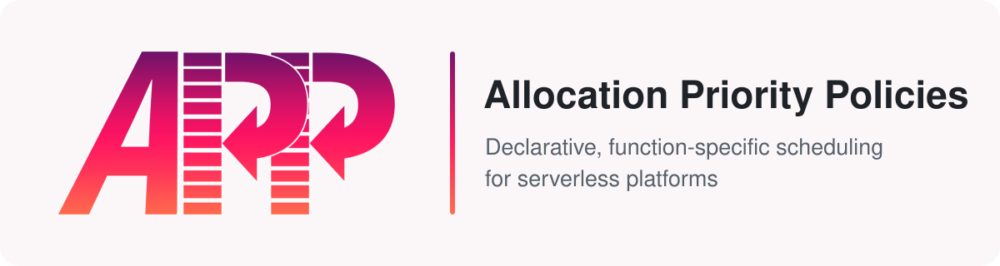

<p align="center">
  <picture>
    <source media="(prefers-color-scheme: dark)" srcset="banner-dark.svg">
    
  </picture>
</p>

---

**APP** (Allocation Priority Policies) is a declarative language for writing scheduling policies for individual functions in Function-as-a-Service (FaaS) platforms. This organisation collects the languages, schedulers, and platforms that the APP research group has built around it.

## Why APP?

Mainstream serverless platforms place functions on workers through a single, hardcoded policy. That works in a uniform public cloud, but not on the **cloud-edge continuum**, where functions often have requirements of their own:

- a function that queries a database should run on workers with low latency to it;
- a function that handles sensitive data must stay on private (edge) nodes;
- functions that exchange a lot of data should run together, while others
  should be kept apart.

Platforms usually meet such needs with ad-hoc deployments. APP instead lets users attach a policy to each function: which workers can host it, in what order of priority, how to choose among them, and when a worker stops being a valid choice. Different policies coexist in the same platform, and the scheduler enforces each one.

## A taste of APP

The policy below states that functions tagged `db_query` should go to the workers in the `db_zone` zone, through that zone's controller, and only to workers using less than 80% of their capacity. If none is available, any worker will do, up to 100 concurrent invocations each. If that fails too, the invocation fails.

```yaml
- db_query:
    - controller: db_zone_ctrl
      workers:
        - set: db_zone
      strategy: best_first
      invalidate:
        - capacity_used: 80%
    - workers: "*"
      strategy: random
      invalidate:
        - max_concurrent_invocations: 100
  followup: fail
```

## The APP family

| Language | Adds | Main reference |
| --- | --- | --- |
| **APP** | Per-function priorities over worker groups, selection strategies, invalidation conditions | [ICSOC 2020](https://doi.org/10.1007/978-3-030-65310-1_29) |
| **tAPP** | Topology awareness: zones, controllers, topology tolerance | [ICWS 2022](https://doi.org/10.1109/ICWS55610.2022.00056), [FGCS 2026](https://doi.org/10.1016/j.future.2026.108691) |
| **aAPP** | Affinity and anti-affinity among functions | [ICSA 2025](https://doi.org/10.1109/ICSA65012.2025.00015) |
| **cAPP** | Cost information derived from function code through static analysis | [STTT 2025](https://doi.org/10.1007/s10009-024-00776-9) |
| **AHAPP** | Distributed scheduling in ad-hoc drone networks | [Ad Hoc Networks 2025](https://doi.org/10.1016/j.adhoc.2025.103951) |

APP also has a [formal semantics](https://doi.org/10.1007/978-3-031-73709-1_19) and a [reachability analysis](https://doi.org/10.1007/978-3-032-10794-7_12) of its policies, used to check quality-of-service and security properties before deployment.

## Implementations

- **[APP for Apache OpenWhisk](https://github.com/giusdp/openwhisk)**: an extension of the OpenWhisk scheduler that enforces APP and tAPP policies
  ([COORDINATION 2024](https://doi.org/10.1007/978-3-031-62697-5_11)).
- **[APP for FunLess](https://github.com/funlessdev/funless)**: a FaaS platform for private edge clouds that runs functions as WebAssembly modules and supports APP scheduling ([ICWS 2024](https://doi.org/10.1109/ICWS62655.2024.00114), [IEEE Internet Computing](https://doi.org/10.1109/MIC.2024.3513035)).

All implementations are open source under the Apache 2.0 licence.

## Publications

- G. De Palma, S. Giallorenzo, J. Mauro, M. Trentin, G. Zavattaro. *Function-specific scheduling policies in cloud–edge serverless systems.* Future Generation Computer Systems, 2026. [doi](https://doi.org/10.1016/j.future.2026.108691)
- G. De Palma, S. Giallorenzo, J. Mauro, M. Trentin, G. Zavattaro. *Towards Implementing Distributed Custom Serverless Function Scheduling in FunLess.* Essays Dedicated to Jean-Bernard Stefani, 2026. [doi](https://doi.org/10.1007/978-3-031-99717-4_12)
- S. Giallorenzo, A. Trotta, F. Bernardi, R. Morelli, A. Remus, A. Santopaolo, F. Schiano, G. Zavattaro. *Ad-Hoc Network Serverless Scheduling in an Industrial Case Study: Drone Swarms in Disaster-Struck Urban Environments.* WoWMoM 2026. [doi](https://doi.org/10.1109/WoWMoM69805.2026.00028)
- G. De Palma, S. Giallorenzo, J. Mauro, M. Trentin, G. Zavattaro. *Reachability Analysis of Function-as-a-Service Scheduling Policies.* IFM 2025. [doi](https://doi.org/10.1007/978-3-032-10794-7_12)
- G. De Palma, S. Giallorenzo, A. Heideker, M. Trentin, A. Trotta, G. Zavattaro. *Distributed serverless function scheduling in ad-hoc drone networks.* Ad Hoc Networks, 2025. [doi](https://doi.org/10.1016/j.adhoc.2025.103951)
- G. De Palma, S. Giallorenzo, J. Mauro, M. Trentin, G. Zavattaro. *Affinity-aware Serverless Function Scheduling.* ICSA 2025. [doi](https://doi.org/10.1109/ICSA65012.2025.00015)
- G. De Palma, S. Giallorenzo, C. Laneve, J. Mauro, M. Trentin, G. Zavattaro. *Leveraging static analysis for cost-aware serverless scheduling policies.* STTT, 2025. [doi](https://doi.org/10.1007/s10009-024-00776-9)
- G. De Palma, S. Giallorenzo, J. Mauro, M. Trentin, G. Zavattaro. *WebAssembly at the Edge: Benchmarking a Serverless Platform for Private Edge Cloud Systems.* IEEE Internet Computing, 2024. [doi](https://doi.org/10.1109/MIC.2024.3513035)
- G. De Palma, S. Giallorenzo, J. Mauro, M. Trentin, G. Zavattaro. *Function-as-a-Service Allocation Policies Made Formal.* ISoLA 2024. [doi](https://doi.org/10.1007/978-3-031-73709-1_19)
- G. De Palma, S. Giallorenzo, J. Mauro, M. Trentin, G. Zavattaro. *FunLess: Functions-as-a-Service for Private Edge Cloud Systems.* ICWS 2024. [doi](https://doi.org/10.1109/ICWS62655.2024.00114)
- G. De Palma, S. Giallorenzo, J. Mauro, M. Trentin, G. Zavattaro. *An OpenWhisk Extension for Topology-Aware Allocation Priority Policies.* COORDINATION 2024. [doi](https://doi.org/10.1007/978-3-031-62697-5_11)
- G. De Palma, S. Giallorenzo, C. Laneve, J. Mauro, M. Trentin, G. Zavattaro. *Serverless Scheduling Policies based on Cost Analysis.* TiCSA 2023. [doi](https://doi.org/10.4204/EPTCS.392.3)
- G. De Palma, S. Giallorenzo, J. Mauro, M. Trentin, G. Zavattaro. *A Declarative Approach to Topology-Aware Serverless Function-Execution Scheduling.* ICWS 2022. [doi](https://doi.org/10.1109/ICWS55610.2022.00056)
- G. De Palma, S. Giallorenzo, J. Mauro, G. Zavattaro. *Allocation Priority Policies for Serverless Function-Execution Scheduling Optimisation.* ICSOC 2020. [doi](https://doi.org/10.1007/978-3-030-65310-1_29)

## People

APP is developed by researchers at the University of Bologna, Inria (OLAS team), and the University of Southern Denmark: Giuseppe De Palma, Saverio Giallorenzo, Jacopo Mauro, Matteo Trentin, and Gianluigi Zavattaro, with Cosimo Laneve on cost analysis and Alexandre Heideker and Angelo Trotta on drone networks. 